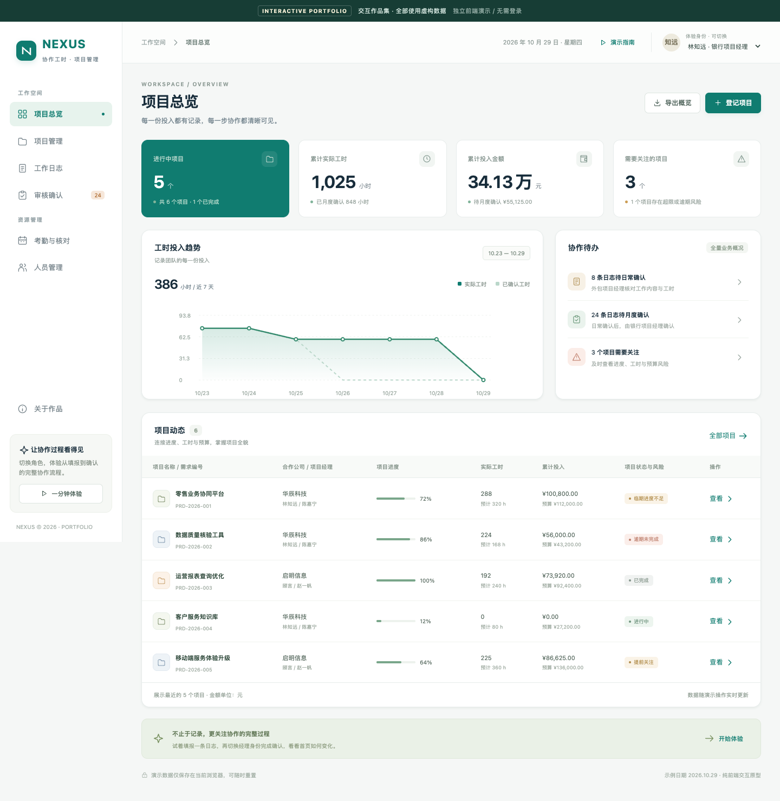
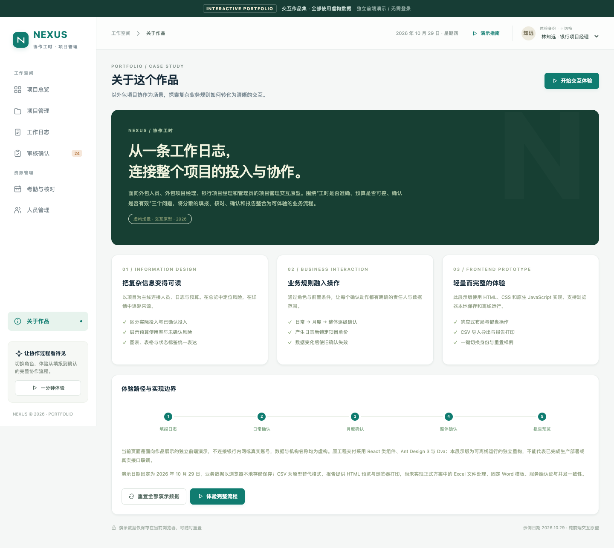
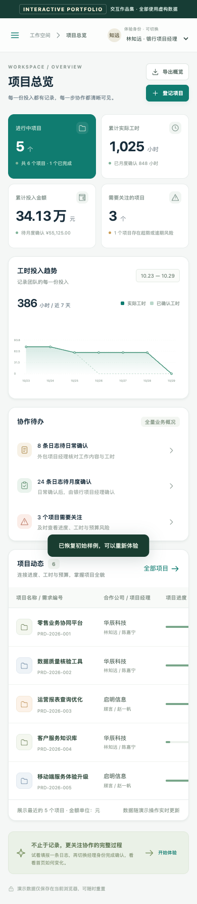

# NEXUS · 协作工时

外包项目工时与预算管理交互作品集。通过四种角色，体验从日志填报到项目工作量确认的完整流程。

**[在线体验 Demo](https://kathytan0818.github.io/nexus-worklog-portfolio/)** · **[下载离线演示包](./nexus-demo-package.zip)** · **[单文件离线版](./nexus-demo.html)**



## 一分钟体验

打开在线 Demo，点击“演示指南”或“一分钟体验”，跟随「客户服务知识库」项目完成：

1. 外包开发人员填写工作日志。
2. 外包项目经理检查并执行日常确认。
3. 银行项目经理核对当月日志并执行月度确认。
4. 银行项目经理复核项目整体实际工作量。
5. 查看项目报告，支持浏览器打印或保存为 PDF。

右上角可切换身份；“关于作品”中可以重置演示数据。无需注册或登录，操作仅保存在访问者自己的浏览器中，不影响其他访问者。

## 功能与业务规则

- 项目总览、工时趋势、预算对比与进度／工时／金额预警。
- 项目登记与修改、成员维护、移除与恢复、预计工时和预算自动汇总。
- 项目约定单价同时用于预算与实际金额计算；产生日志后锁定，账号默认价格变化不影响历史项目。
- 日志按人员、项目、日期唯一，支持本人修改，工时按 0.5 小时填写。
- 日常确认 → 月度确认 → 整体确认逐级衔接；修改日志会清空相关确认。
- 付款状态独立维护，不随各级确认自动变化。
- 按人员、月份跨项目核对日志与考勤；管理员可校验并导入考勤 CSV。
- 按筛选范围导出全部 CSV 数据；整体确认后开放项目报告预览和打印。
- 响应式布局、角色体验、键盘焦点处理与本地保存。

## 技术与依赖

使用 **HTML、CSS、原生 JavaScript、SVG 和 localStorage**。运行时没有第三方依赖，不需要安装 Node、npm 包或 Python，也不需要后端。

Python 3 仅用于重新生成离线交付包，使用标准库，无需 pip 安装。

## 本地查看

直接用浏览器打开 `index.html` 或 `nexus-demo.html`。也可在仓库目录启动静态服务器：

```sh
python3 -m http.server 8767 --bind 127.0.0.1
```

再访问 `http://127.0.0.1:8767`。

## 文件结构

| 文件 | 用途 |
| --- | --- |
| `index.html` | 网站入口 |
| `app.js` | 演示数据、业务计算与界面交互 |
| `style.css` | 页面样式、响应式布局与打印样式 |
| `build.py` | 生成单文件 HTML 和离线 ZIP |
| `nexus-demo.html` | 已内嵌全部脚本、样式和图标的离线版本 |
| `nexus-demo-package.zip` | 源码、离线 Demo、截图和说明 |
| `dashboard.png` / `about.png` / `mobile.png` / `report.png` | 界面预览 |
| `QA.md` | 已验证范围及限制 |

修改源码后，执行：

```sh
python3 build.py
```

## GitHub Pages

在仓库 `Settings → Pages` 中选择 `Deploy from a branch`，使用 `main` 分支、`/ (root)` 目录。仓库根目录的 `index.html` 是发布入口。静态资源使用相对路径，支持 GitHub 项目站点的子路径。

## 实现边界

这是独立的前端交互原型，全部项目、人员和机构数据均为虚构，不包含真实账号、密码、内网接口或业务凭证。示例日期固定为 **2026-10-29**，便于重复演示。

前端角色限制仅演示业务边界，不能代替服务端鉴权。没有真实数据库、认证、并发事务或生产审计。正式方案的 Excel 文件处理在此使用明确标注的 CSV 替代，固定 Word 模板在此使用 HTML 报告和浏览器打印替代。

原工程采用 React 类组件、Ant Design 3 和 Dva；此仓库是为独立展示重构的原生前端版本，不代表已完成原工程的真实接口联调或生产上线。

## 更多预览




